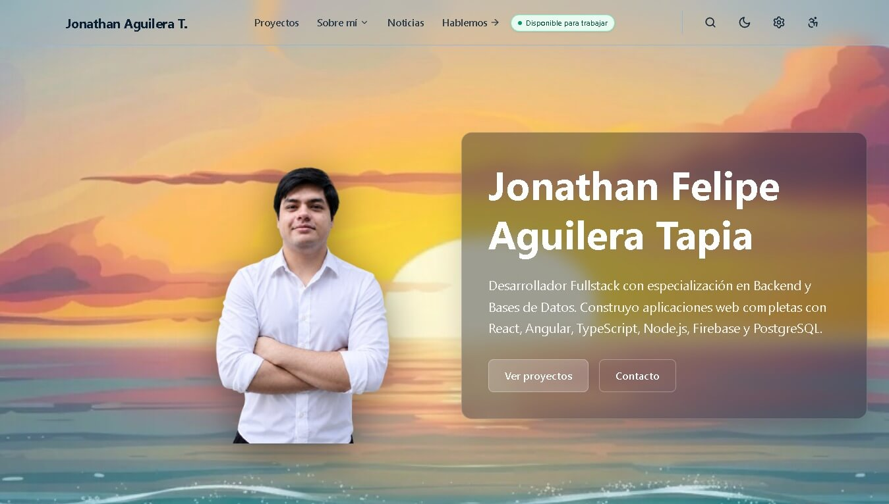
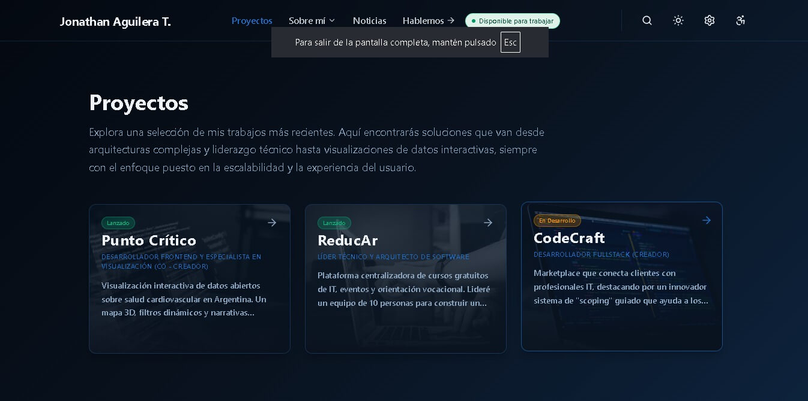
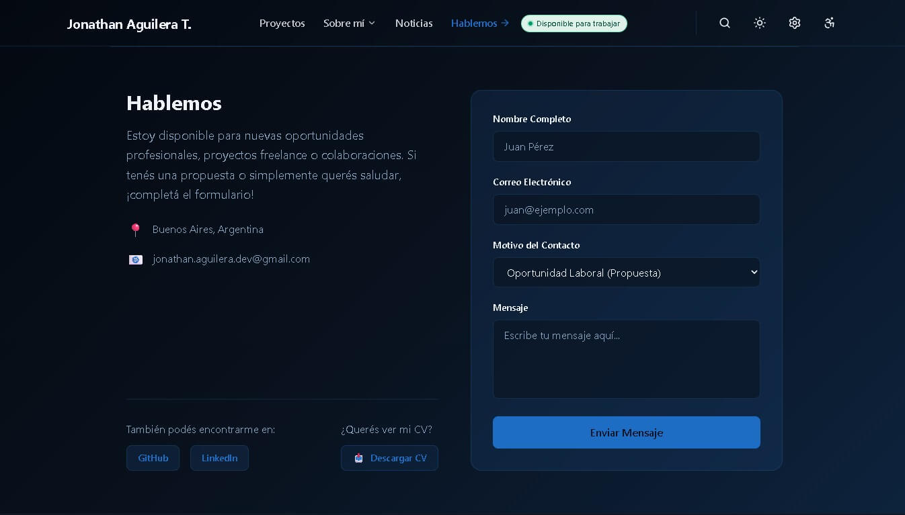
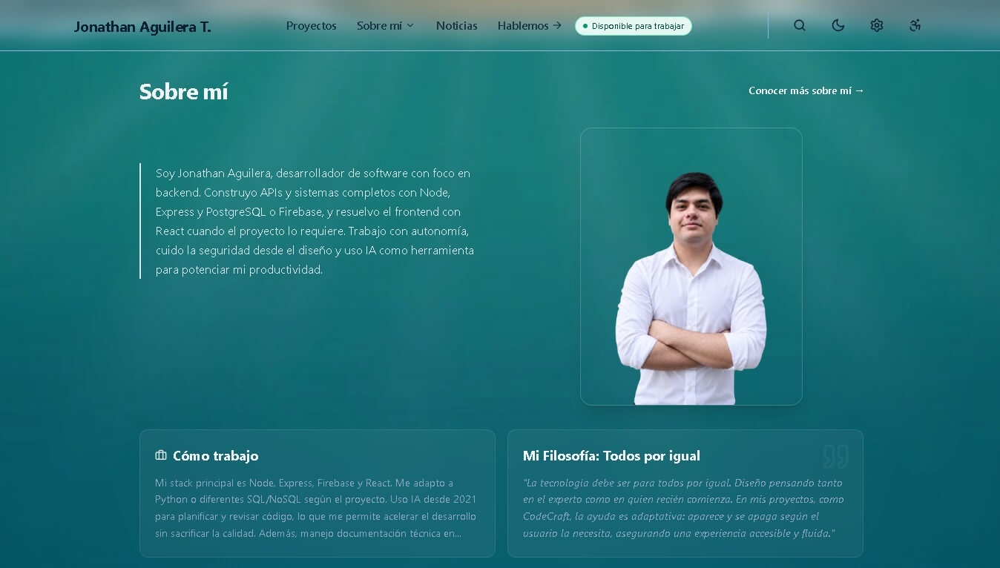
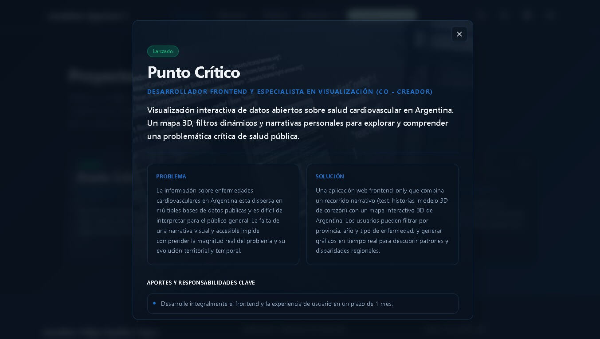

# Portafolio — Jonathan Aguilera

<div align="center">

[](https://portfolio-jonathan-aguilera.vercel.app/)


**Sitio en vivo:** https://portfolio-jonathan-aguilera.vercel.app/ <br />
**LinkedIn:** https://www.linkedin.com/in/jonathanfullstack <br />
**Contacto:** timestormcreations@gmail.com

</div>

## Portafolio profesional

Desarrollador fullstack con foco en backend y bases de datos. Este sitio reúne en un único lugar mi trayectoria, los proyectos que llevé a producción, mi formación y las herramientas con las que trabajo a diario.

No es un CV escaneado ni una plantilla: es una aplicación con rutas propias, contenido tipado y un sistema visual (claro/oscuro, acentos marinos) construido desde cero. Cada vista responde a una pregunta concreta: qué construí, cómo lo construí y por qué tomé esas decisiones.

> "Tecnología para todos por igual."

---

## Sobre el proyecto

**Mi proyecto: Portafolio personal.**

Lo usé como excusa para mostrar criterio de producto y capacidad de llevar algo de cero a producción, más que como vidriera de librerías. Por eso las decisiones que más peso tienen acá no son qué framework uso, sino cómo se organiza el contenido, cómo se resuelve el contacto sin backend y qué pasa cuando alguien navega con lector de pantalla, con datos móviles o en un equipo viejo.

**Decisión de fondo: no tener backend.**

Al no depender de un servidor propio, hay servicios y metodologías que cambian su uso cotidiano para suplir esas dependencias:

- El formulario de contacto se resuelve con **EmailJS**, sin manejar credenciales sensibles ni datos de usuarios en un `.env` del servidor.
- El contenido (proyectos, experiencia, formación, habilidades, noticias) vive en el repositorio como **módulos TypeScript tipados**, no en una base de datos. Cambiar un proyecto es editar un archivo y abrir un PR.
- El despliegue es estático, con reglas de rewrite para que el ruteo del cliente funcione en cualquier URL profunda.

El costo asumido es explícito: dependencia de un tercero para el correo, contenido que requiere deploy para actualizarse y ausencia de analítica propia. Está anotado en el roadmap cuando deja de ser un costo aceptable.

---

## Stack por capas

| Capa | Tecnología | Versión | Rol en el proyecto |
| :--- | :--- | :--- | :--- |
| UI | **React** | 19 | Componentes, hooks y composición de vistas |
| Lenguaje | **TypeScript** | 6.0 | Tipado del contenido y de las props de cada componente |
| Build | **Vite** | 8.3 | Servidor de desarrollo, HMR y empaquetado |
| Estilos | **Tailwind CSS** | 4.3 | Sistema de tokens (`@theme`) y utilidades en el JSX |
| Ruteo | **React Router DOM** | 7.18 | Rutas anidadas, layouts y detalle por `slug` |
| Iconografía | **Lucide React** | 1.77 | Set de iconos consistente y tree-shakeable |
| Formulario | **@emailjs/browser** | 5.0 | Envío del formulario de contacto sin backend |
| Linting | **Oxlint** | 1.88 | Chequeo estático rápido sobre todo el código |
| Tipos de entorno | **@types/node** | 24 | Tipado de `process`, `path` y utilidades de Vite |

**Node requerido:** 24 o superior (LTS actual al momento de escribir esto).

---

## Funcionalidades

- **Home** — concentra la presentación, el estado de disponibilidad y accesos directos a cada sección, sin obligar a navegar el menú.
- **Proyectos** — muestra cada proyecto con rol, problema, solución, stack y estado (*Lanzado* / *En desarrollo*), con enlaces al repositorio y a la demo cuando existen.
- **Mi historia** — relato formal del perfil: intereses, foco profesional y propósito, separado del CV cronológico.
- **Mi experiencia** — historial laboral con descripción de responsabilidades, ubicación, fechas y logros concretos.
- **Formación** — distingue estudios universitarios de cursos y capacitaciones intensivas, con institución y período.
- **Habilidades** — agrupa competencias por Frontend, Backend y Bases de Datos, y diferencia uso principal, tecnologías en exploración y próximos pasos.
- **Noticias** — listado de novedades con vista de detalle por `slug`, para publicar cambios del sitio sin reescribir secciones.
- **Hablemos** — formulario de contacto con motivo, validación de campos y envío vía EmailJS, más un límite de un envío por hora guardado en `localStorage`.
- **Configuración** — panel de preferencias (idioma, ahorro de batería, sensibilidad de interacción, notificaciones y cookies). Hoy es una maqueta funcional a nivel UI, sin persistencia.
- **Accesibilidad** — panel con reducción de movimiento, alto contraste, tamaño de texto, espaciado, subrayado y resaltado de enlaces, cursor grande y guía de lectura.
- **Legales** — aviso legal, privacidad, cookies, declaración de accesibilidad y mapa del sitio, como rutas independientes.
- **Tema claro / oscuro** — conmutador sol/luna con transición circular nativa (*View Transitions*), respeto de `prefers-color-scheme` y persistencia en `localStorage`.
- **Navegación SPA** — layouts separados para Home y para el resto del sitio, con restauración de scroll al cambiar de ruta.
- **404 propio** — ruta comodín con salida a las secciones principales, en lugar del error del servidor.

---

## Capturas

| Home | Proyectos | Hablemos |
| :---: | :---: | :---: |
|  |  |  |
| Hero y presentación | Listado con estado y stack | Formulario y canales directos |

| Home — primera sección | Proyectos — detalle |
| :---: | :---: |
|  |  |

---

## Cómo correrlo localmente

Requisitos: **Node 24+** y **npm 10+**. No hace falta configurar nada para ver el sitio; las variables de entorno solo afectan el envío del formulario.

```bash
git clone https://github.com/Jonathan-Aguilera/portfolio-jonathan-aguilera.git
cd portfolio-jonathan-aguilera/front
npm install
npm run dev
```

Vite levanta el servidor en `http://localhost:5173` y abre el navegador automáticamente.

---

## Variables de entorno

El formulario de contacto necesita tres claves públicas de EmailJS. Creá un archivo `.env` dentro de `front/` (está ignorado por Git) tomando como base un `.env.example`:

```bash
# front/.env.example
VITE_EMAILJS_SERVICE_ID=tu_service_id
VITE_EMAILJS_TEMPLATE_ID=tu_template_id
VITE_EMAILJS_PUBLIC_KEY=tu_public_key
```

| Variable | Dónde se obtiene | Para qué sirve |
| :--- | :--- | :--- |
| `VITE_EMAILJS_SERVICE_ID` | Panel de EmailJS → Email Services | Identifica el servicio de correo que recibe el mensaje |
| `VITE_EMAILJS_TEMPLATE_ID` | Panel de EmailJS → Email Templates | Define el formato y el destinatario del correo |
| `VITE_EMAILJS_PUBLIC_KEY` | Panel de EmailJS → Account | Autentica el envío desde el navegador |

**Aclaración importante:** estas variables únicamente habilitan la conexión de la vista de contacto con mi correo. Sin ellas el proyecto compila y navega normalmente; solo el botón de envío del formulario falla.

---

## Scripts

| Comando | Qué hace |
| :--- | :--- |
| `npm run dev` | Levanta Vite en modo desarrollo sobre `http://localhost:5173`, con HMR y apertura automática del navegador (`vite --open`). |
| `npm run build` | Valida tipos con `tsc -b` y genera el bundle de producción en `front/dist/`. |
| `npm run preview` | Sirve el contenido de `dist/` en `http://localhost:4173` para revisar el build antes de publicar. |
| `npm run lint` | Ejecuta Oxlint sobre el proyecto y reporta problemas de estilo y reglas. |

---

## Estructura

```text
Portafolio/
├── front/
│   ├── public/                 # Archivos estáticos servidos tal cual (robots.txt, iconos)
│   ├── src/
│   │   ├── assets/             # Imágenes de fondo, avatar e icono del sitio
│   │   │   └── docs/           # Capturas usadas en este README
│   │   ├── components/         # Piezas reutilizables: cards de proyecto, formación, skills…
│   │   │   └── ui/             # Átomos de interfaz: badge de disponibilidad, scroll al top
│   │   ├── constants/          # Valores fijos compartidos (reservado, aún sin uso)
│   │   ├── data/               # Contenido del sitio tipado: proyectos, experiencia, skills…
│   │   ├── hooks/              # Hooks propios (reservado, aún sin uso)
│   │   ├── layouts/            # Header, navbar, footer y los dos layouts de ruta
│   │   ├── pages/              # Una vista por ruta, incluidas legales y errores
│   │   │   ├── legal/          # Aviso legal, privacidad, cookies y accesibilidad
│   │   │   └── errors/         # Página 404
│   │   ├── sections/           # Bloques de la Home y sus previews por sección
│   │   ├── types/              # Contratos de datos que consumen data/ y las vistas
│   │   ├── utils/              # Utilidades puras (reservado, aún sin uso)
│   │   ├── App.tsx             # Definición de rutas y layouts
│   │   ├── index.css           # Tokens de tema, modo oscuro y mapeo a Tailwind v4
│   │   └── main.tsx            # Punto de entrada de React
│   ├── index.html              # Shell HTML con metadatos y Open Graph
│   ├── vercel.json             # Rewrites de SPA para el despliegue
│   └── package.json            # Dependencias y scripts
├── README.md                   # Este documento
└── .gitignore                  # Excluye node_modules, dist y archivos .env
```

---

## Decisiones técnicas

- **React en lugar de Angular o Next.js.**
  - *Por qué:* necesitaba control total sobre la composición visual y reutilización de componentes sin las convenciones de framework que impone un meta-framework.
  - *Trade-off:* pierdo el enrutado por archivos y el renderizado en servidor de Next; la responsividad y el SEO hay que resolverlos a mano.

- **Vite en lugar de Next.js como entorno de build.**
  - *Por qué:* el sitio es estático y de una sola página; Vite arranca en milisegundos y el bundle es mínimo.
  - *Trade-off:* no hay SSR ni generación estática integrada; si el contenido necesita indexarse mejor, habrá que migrar o prerenderizar.

- **Tailwind CSS v4 en lugar de CSS plano o una librería de componentes.**
  - *Por qué:* los tokens viven en un solo archivo (`@theme` en `index.css`) y los estilos quedan junto al markup, lo que evita CSS muerto.
  - *Trade-off:* el JSX se llena de clases y hay una curva de aprendizaje mayor frente a Bootstrap; además, migrar de v3 a v4 implicó reescribir la configuración.

- **Oxlint en lugar de ESLint.**
  - *Por qué:* es sensiblemente más rápido y su configuración es mínima para un proyecto de este tamaño.
  - *Trade-off:* ecosistema de reglas y plugins mucho menor; algunas integraciones con editores todavía son inmaduras.

- **EmailJS en lugar de un backend propio.**
  - *Por qué:* resuelve el contacto sin servidor, sin base de datos y sin almacenar credenciales sensibles.
  - *Trade-off:* dependencia de un servicio de terceros, límite de envíos en el plan gratuito y poca personalización del flujo de correo.

- **Contenido en módulos TypeScript en lugar de CMS o API.**
  - *Por qué:* el sitio es de una sola persona; un archivo tipado da autocompletado, errores en build y cero infraestructura.
  - *Trade-off:* cada actualización exige un commit y un deploy; publicar noticias desde el móvil, por ejemplo, no es posible.

---

## Roadmap

- [x] Definir el modelo de datos del contenido y tiparlo (`types/` + `data/`)
- [x] Montar rutas anidadas con layouts diferenciados para Home y páginas internas
- [x] Implementar tema claro/oscuro con persistencia y transición nativa
- [x] Conectar el formulario de contacto con EmailJS y limitar envíos por hora
- [x] Publicar las vistas legales y la declaración de accesibilidad
- [x] Configurar rewrites de SPA para despliegue estático
- [ ] Unificar el modo diurno y nocturno: hoy los tokens de Home y del resto del sitio no están del todo alineados
- [ ] Persistir en `localStorage` las preferencias de Configuración y Accesibilidad (hoy son estado en memoria)
- [ ] Pulir el proyecto en pantallas pequeñas: navegación, tamaños de fuente y espaciados
- [ ] Reemplazar los enlaces placeholder de LinkedIn, Instagram y YouTube por los perfiles reales
- [ ] Implementar la descarga real del CV (hoy es un `alert` de simulación)
- [ ] Añadir el archivo `LICENSE` y el enlace correspondiente en este README
- [ ] Dividir el bundle por ruta con `React.lazy` y medir el impacto con Lighthouse
- [ ] Incorporar tests base (Vitest + Testing Library) y una auditoría de accesibilidad automatizada
- [ ] Optimizar imágenes de fondo (formatos y tamaños responsivos)

---

## Contacto

Estoy abierto a oportunidades laborales, proyectos freelance y colaboraciones.

| Canal | Enlace |
| :--- | :--- |
| **Email** | [timestormcreations@gmail.com](mailto:timestormcreations@gmail.com) |
| **LinkedIn** | [linkedin.com/in/jonathanfullstack](https://www.linkedin.com/in/jonathanfullstack) |
| **GitHub** | [github.com/Jonathan-Aguilera](https://github.com/Jonathan-Aguilera) |
| **YouTube** | [youtube.com/channel/UC_IgEWuUVBk1F6nlvYe4jRw](https://www.youtube.com/channel/UC_IgEWuUVBk1F6nlvYe4jRw) |
| **Instagram** | [@jackkciroesc](https://instagram.com/jackkciroesc) |
| **Sitio** | [portfolio-jonathan-aguilera.vercel.app](https://portfolio-jonathan-aguilera.vercel.app/) |

---

## Licencia

Este proyecto se distribuye bajo la **licencia MIT**. Podés usarlo, modificarlo y redistribuirlo, incluso con fines comerciales, siempre que conserves el aviso de copyright y el texto de la licencia. Se entrega **sin garantía** de ningún tipo.

Copyright (c) 2026 Jonathan Aguilera.
